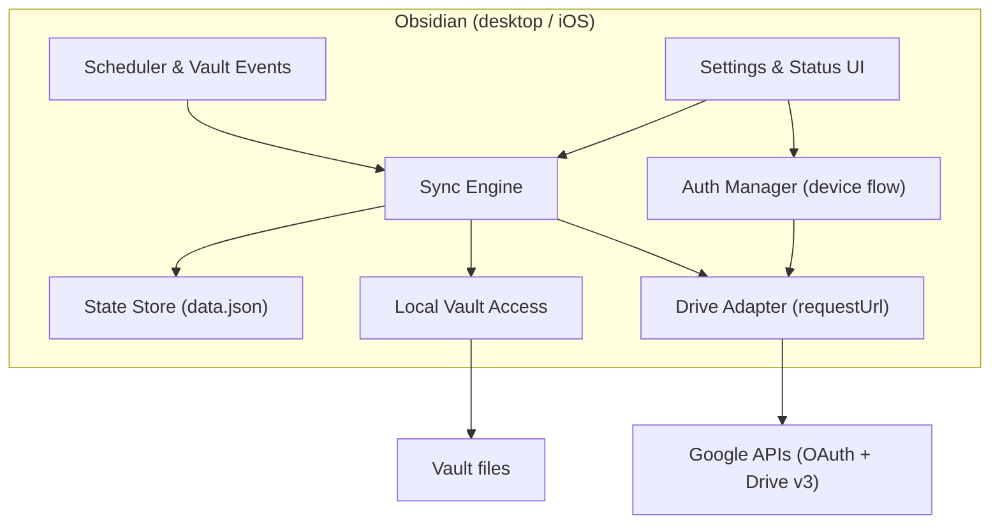
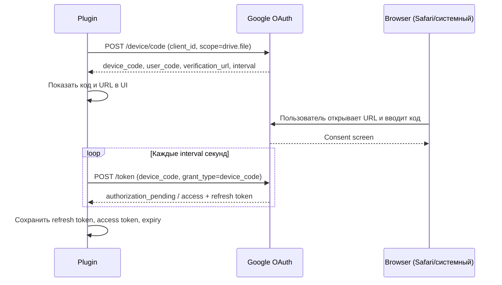

# Архитектура GDrive BYO Sync

Статус: черновик этапа 01, решения зафиксированы, код не реализован. Алгоритм синхронизации детально описан в `SYNC_ALGORITHM.md`.

## 1. Цели и не-цели

### Цели

- Двусторонняя синхронизация vault с Google Drive на Windows, macOS 13+ и iOS.
- Работа с собственными OAuth-креденшелами пользователя (BYO), без серверов автора и подписок.
- Предсказуемые и безопасные конфликты/удаления, отсутствие потери данных.
- Готовность к публикации в community plugins.

### Не-цели (MVP)

- Синхронизация Google Docs/Sheets/Slides как файлов (только обычные бинарные/текстовые файлы).
- Автоматический merge markdown-конфликтов.
- Фоновая синхронизация на iOS (платформа не даёт гарантий).
- Совместная работа с одним vault из нескольких устройств одновременно без конфликтов (конфликты сохраняются как копии).
- Мультиаккаунтность и несколько remote-папок на один vault.

## 2. Платформенные ограничения

| Ограничение | Следствие для архитектуры |
| --- | --- |
| Mobile Obsidian без Node API | Никакого локального HTTP-сервера, никакого `fs`. Только Obsidian API + `requestUrl` |
| Google запретил custom URI scheme редиректы | На iOS нельзя сделать `obsidian://` redirect; loopback на iOS/Android deprecated |
| Consent screen в статусе Testing: refresh token живёт 7 дней | Инструкция требует перевести проект в «In production»; scope `drive.file` non-sensitive, верификация не обязательна |
| Device flow поддерживает только `drive.appdata` и `drive.file` из Drive-скоупов | Используем ровно `drive.file` |
| Drive разрешает одинаковые имена файлов в одной папке | Индекс по пути + `fileId`; дубликаты — конфликт/предупреждение, не автоудаление |
| Drive API — не filesystem: нет стабильных путей, только ID и parent | Полное зеркало дерева папок; путь восстанавливается из дерева |
| macOS 13+, mobile WebView | `target: es2018`, без Node-специфичных API; iOS проверяется отдельно |
| iOS приостанавливает JS при уходе в фон | Синк по запуску/возврату в приложение + ручной, таймеры не гарантируются |

## 3. Ключевые решения (ADR)

| # | Решение | Обоснование | Альтернативы |
| --- | --- | --- | --- |
| ADR-001 | Scope только `drive.file` | Non-sensitive: без обязательной верификации Google; минимальные права; разрешён в device flow | `drive`/`drive.readonly` — restricted, требуют security assessment; `drive.appdata` — файлы не видны пользователю |
| ADR-002 | Основной auth — device flow (client type «TVs and Limited Input devices») | Работает на desktop и iOS без сервера автора и без redirect URI; выдаёт refresh token | Relay-сайт (как Remotely Save) — инфраструктура автора; loopback — не работает на iOS; custom scheme — запрещён Google |
| ADR-003 | Loopback + PKCE опционально для desktop | Лучший UX на desktop (без копирования кода) | Требует второй OAuth client type; не для MVP |
| ADR-004 | State-based three-way diff без журнала операций | Проще и устойчивее к пропущенным событиям; состояние — единственный источник правды | Operation log — сложнее синхронизировать между устройствами |
| ADR-005 | Полный скан метаданных remote вместо Changes API | `files.list` доступен при `drive.file` и дешёв (до 1000 файлов на страницу); Changes API требует более широких scope | Changes API — возможная оптимизация, если совместим |
| ADR-006 | Никогда не удалять безвозвратно | Drive → trash (восстановимо), локально → `.trash` Obsidian | Permanent delete — недопустимый риск |
| ADR-007 | Конфликт сохраняет обе версии | Потеря данных недопустима; ручное разрешение предсказуемо | Auto-merge — ошибки дороже; «побеждает новее» — теряет правки |
| ADR-008 | Отсутствие считается удалением только после полного успешного скана | Защита от удаления при неполном листинге/ошибке сети | Удаление по частичному скану — опасный баг |
| ADR-009 | `requestUrl` вместо `fetch` | Не зависит от CORS, одинаково работает на desktop и mobile | `fetch` может блокироваться CORS на mobile |
| ADR-010 | Состояние и токены в `data.json` плагина | Штатный механизм Obsidian, работает на mobile | IndexedDB/файлы — сложнее и не стандартно |
| ADR-011 | ES2018, без Node API | Старый macOS и mobile | Современный ES — рискуем сломать старые Electron |

## 4. Компоненты



### Модули (планируемая структура `src/`)

- `main.ts` — жизненный цикл плагина, команды, статус-бар.
- `settings.ts` — схема настроек, вкладка настроек, мастер подключения.
- `auth/` — device flow, хранение и обновление токенов, revoke.
- `drive/` — Drive API клиент, метаданные, upload/download, retry.
- `sync/` — state, сканер, diff, операции, конфликты, deletions, очередь.
- `local/` — доступ к vault, события, игноры, хеширование.
- `shared/` — утилиты, типы, ошибки, лог.

## 5. Аутентификация

### 5.1. Модель BYO

Пользователь создаёт в собственном Google Cloud проекте OAuth-клиент типа **TVs and Limited Input devices**, включает Drive API, задаёт scope `drive.file` и переводит приложение в статус **In production** (иначе refresh token истечёт через 7 дней). Client ID и client secret вставляются в настройки плагина.

### 5.2. Device flow (основной)



Особенности:

- Polling продолжается после возврата приложения из фона; device_code живёт ~30 минут.
- При ошибках `slow_down` интервал увеличивается.
- Refresh token выдаётся всегда.
- `invalid_client` означает не тот тип OAuth-клиента — типичная ошибка, надо обрабатывать понятным сообщением.

### 5.3. Обновление токенов

- Access token хранится с `expires_at` (за 60 секунд до истечения считается протухшим).
- При `401` — один retry после refresh; при `invalid_grant` — статус «нужно переподключиться», синк останавливается, пользователю показывается инструкция.
- При отключении — вызов `/revoke` и очистка токенов.

### 5.4. Безопасность

- Client secret — публичный по своей природе (installed app), но всё равно хранится локально и не коммитится.
- Refresh token = доступ к файлам, созданным плагином. `data.json` нельзя синхронизировать, коммитить и пересылать.
- Плагин не добавляет сетевые вызовы никуда, кроме `googleapis.com` и `accounts.google.com`.

## 6. Drive Adapter

### 6.1. Модель remote

- Корневая папка плагина: `My Drive/Obsidian/<vault-name>/` — создаётся плагином, вложенная структура повторяет vault.
- Поиск корневой папки: `files.list` с `q = "mimeType='application/vnd.google-apps.folder' and 'root' in parents and name='...' and trashed=false"`; при нескольких кандидатах — предупреждение.
- Каждый файл/папка получает `appProperties`: `vaultId` и `syncRevision` (без длинных путей из-за лимита значений).
- Путь файла восстанавливается обходом дерева `parents` от корня; `fileId` — стабильный ключ.

### 6.2. Используемые методы

| Операция | Drive API |
| --- | --- |
| Полный листинг метаданных | `files.list` (поля: id, name, mimeType, parents, modifiedTime, md5Checksum, size, trashed, appProperties), pageSize 1000 |
| Скачивание | `files.get?alt=media` |
| Создание файла | `files.create` (multipart, metadata + content) |
| Обновление содержимого | `files.update` (multipart) |
| Создание папки | `files.create` с `mimeType=application/vnd.google-apps.folder` |
| Перемещение/переименование | `files.update` (`name`, `addParents`/`removeParents`) |
| Удаление | `files.update` `trashed=true` |

### 6.3. Хеши и сравнение содержимого

- Drive отдаёт `md5Checksum` для загруженных бинарных файлов. Локально считаем MD5 (лёгкая библиотека, работает на mobile).
- Локальный хеш считается только при изменении `mtime`/размера или отсутствии записи в state.
- Google-native файлы (`application/vnd.google-apps.*`) игнорируются: у них нет md5 и контента для скачивания.

### 6.4. Надёжность

- Retry с экспоненциальной задержкой и джиттером на `429`, `403 rateLimitExceeded`, `5xx`; лимит попыток.
- Ограничение параллелизма (4–6 операций), чтобы не выжигать квоту.
- Таймауты и отмена при выключении плагина.
- Ошибка одной операции не роняет весь синк: она попадает в очередь ошибок и повторяется в следующем проходе.

## 7. Sync Engine

Подробная таблица решений — в `SYNC_ALGORITHM.md`. Здесь верхнеуровнево.

- Вход: локальный скан vault, remote-скан метаданных, состояние последней синхронизации.
- Для каждого пути вычисляется `localChanged` / `remoteChanged` относительно базы.
- Операции: upload, download, create folder, trash remote, trash local, conflict copy, adopt (ничего не делать).
- Состояние обновляется **после** успешного выполнения операции; падение в середине безопасно, потому что повторный скан приведёт к тем же решениям (идемпотентность).
- Синк сериализован: одна активная сессия, параллельные запуски игнорируются.
- Первичный синк без базы — только безопасный merge: никаких удалений, разные версии одного пути → conflict copy.

### Индекс (state)

```ts
type SyncState = {
  schemaVersion: 1;
  vaultId: string;
  remoteRootId: string | null;
  lastFullScanAt: string | null;
  lastSyncAt: string | null;
  files: Record<string, FileState>; // ключ — путь от корня vault, forward slashes
};

type FileState = {
  fileId: string;
  parentId: string;
  md5: string;
  size: number;
  localMtime: number;
  remoteModifiedTime: string;
  syncedAt: string;
};
```

- Папки хранятся отдельной картой (`folders: Record<path, folderId>`) либо выводятся из дерева при скане.
- `schemaVersion` позволяет мигрировать формат.
- Сохранение — debounced, но не реже одного раза на пакет операций.

## 8. Локальная часть

- Источник истины — Obsidian API: `vault.getFiles()`, `readBinary`, `modifyBinary`, `create`, `createFolder`, `trash`, `rename`.
- События vault (`create`, `modify`, `delete`, `rename`) ставят пути в очередь с debounce 2–5 секунд.
- Периодический полный скан (по умолчанию раз в 10 минут, пока Obsidian открыт) — страховка от пропущенных событий.
- Игноры: `.obsidian/workspace*.json`, `.obsidian/cache/**`, `.trash/**`, `node_modules/**`, `.git/**`, data.json плагина, размер больше лимита.
- Синхронизация `.obsidian`: отдельная настройка (по умолчанию выключена), с явным списком исключений.

## 9. UI / UX

- Вкладка настроек: статус подключения, мастер Google Cloud, выбор папки, лимиты, расписание, игноры.
- Команды: `Sync now`, `Connect Google Drive`, `Disconnect`, `Show sync log`.
- Статус-бар: идле / синк / ошибка / «нужно переподключиться».
- Notice — только о значимых событиях (первый синк завершён, конфликт, ошибка), без спама.
- Диагностический лог — кольцевой буфер в памяти + опция сохранить в файл для issue.

## 10. Конфигурация (черновик настроек)

| Ключ | Тип | По умолчанию | Назначение |
| --- | --- | --- | --- |
| `clientId` | string | — | OAuth client ID пользователя |
| `clientSecret` | string | — | OAuth client secret (хранится локально) |
| `remoteFolderName` | string | `Obsidian` | Корневая папка в Drive |
| `vaultFolderName` | string | имя vault | Подпапка | 
| `syncIntervalMinutes` | number | 10 | Периодический скан |
| `syncOnSave` | boolean | false | Синк после сохранения |
| `syncConfigFolder` | boolean | false | Синхронизировать `.obsidian` (без workspace) |
| `excludedPatterns` | string[] | служебные | Игноры |
| `maxFileSizeMb` | number | 25 mobile / 100 desktop | Пропуск больших файлов |
| `conflictPolicy` | enum | `keepBoth` | Пока только keepBoth |

## 11. Ошибки и наблюдаемость

- Все ошибки типизированы: `AuthError`, `RateLimitError`, `NetworkError`, `RemoteConflictError`, `LocalError`.
- Пользовательские сообщения — на понятном языке + ссылка на troubleshooting.
- Лог: время, тип, путь, действие, результат; без содержимого заметок.
- При критических ошибках синк останавливается до ручного запуска, статус-бар показывает ошибку.

## 12. Тестирование

- Unit: diff-таблица решений, конфликтные имена, path-нормализация, игноры, state-миграции. Drive и локальный FS — через интерфейсы с моками.
- Contract: Drive adapter против мок-сервера (локальный JSON API), включая пагинацию, retry, ошибки квоты.
- Интеграционные ручные сценарии: полный цикл на тестовом аккаунте Google, сценарии конфликтов (правки на двух устройствах), удаления, первичный merge на пустом и непустом remote.
- Матрица устройств: Windows, macOS 13+, iPhone. Результаты фиксируются в `docs/` по мере выполнения.

## 13. Риски

| Риск | Влияние | Смягчение |
| --- | --- | --- |
| Политика Google к device flow на телефонах | Среднее | Зафиксировать в RESEARCH_NOTES; запасной путь — loopback на desktop и relay только как fallback |
| `drive.file` не видит файлы, загруженные вручную | UX | Явно объяснить в документации и мастере; опция «загрузить vault в Drive через плагин» |
| Пользователь не настроит Google Cloud | Высокое | Мастер со скриншотами, проверка credentials до первого синка, видео/гайд |
| 7-дневный refresh token в Testing | Высокое | Проверка статуса в мастере: «переведите приложение в In production» |
| Дубликаты имён в Drive | Среднее | Индекс по fileId; дубликаты — предупреждение, ручное разрешение |
| Пропущенные события vault | Среднее | Периодический полный скан |
| Потеря данных при crash | Критическое | Trash вместо delete, state после операции, идемпотентность |
| iOS-память на больших файлах | Среднее | Лимит размера по умолчанию, пропуск без ошибки |
| Магазин плагинов: жалобы на настройку OAuth | Среднее | README + troubleshooting + понятные ошибки |

## 14. Следующие шаги

1. `npm install && npm run build` — проверить каркас.
2. Реализовать device flow и хранение токенов (этап 02).
3. Реализовать Drive adapter и полный скан (этап 03).
4. Реализовать sync engine (этап 04).
5. Мобильная проверка и публикация.
